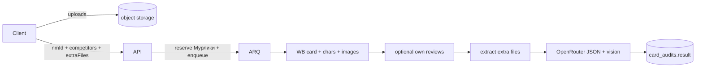

# ИИ-аудит карточки товара

## Назначение

Модуль `card_audit` запускает AI-аудит карточки Wildberries: своя карточка + опциональные конкуренты + опциональный сбор отзывов/вопросов **внутри аудита**. Результат — структурированный отчёт и промт для генерации контента. Списание — **Мурлики** (`card_audit/*` в каталоге весов).

**Отдельно от** `reviews_analysis`: флаг «учитывать отзывы» не подтягивает готовый анализ отзывов — он запускает собственный compact-сбор WB feedbacks/questions.

## Как связан skill `marketplace-card-analysis`

В репозитории лежит пакет [`marketplace-card-analysis/`](../../marketplace-card-analysis/SKILL.md). Это **не** прод-агент и **не** отдельный сервис.

| В skill | В продукте |
|---------|------------|
| `SKILL.md` + `references/*.md` | Curated expert md в `card_audit/.../llm/knowledge/` → system prompt |
| `scripts/wb_collect.mjs`, `wb_audit.mjs` | Python-сборщик карточки/конкурентов + отзывов в worker job |
| `chooseCategoryRoute` | `category_route.py`: clothing / pet-grooming / general-goods |
| `references/report-template.md`, `generation-and-ab.md` | JSON-схема отчёта (~разделы шаблона) + блок generation в knowledge |
| `agents/openai.yaml`, OpenAI Skills API | **Не используются** (рантайм — OpenRouter chat completions, в т.ч. vision) |
| `expert-source/`, `expert-rule-ledger.md` | Не грузятся в каждый аудит |
| Browser-досбор, полки, реклама | **Вне MVP** (quick-режим skill) |

## MVP (quick)

Вход: свой `nmId`, до 5 конкурентов, флаг `useReviews`, опциональные доп. файлы владельца (`extraFiles` + `extraNote`), опционально `organizationId`.

1. `POST /uploads` — до 10 файлов (таблицы, документы, изображения) → ключи в storage (`card-audit/{userId}/…`).
2. Reserve Мурликов: `compute_cost(card_audit, use_reviews, competitor_count)` (UI берёт сумму через `POST /estimate-cost`). Доп. файлы стоимость не меняют.
3. Fetch своей карточки и конкурентов (`card.wb.ru` + basket `card.json` через curl_cffi impersonate Safari — wbaas даёт 403 на TLS OpenSSL и на impersonate Chrome; характеристики/composition/colors/цена из `sizes[].price` + `rich_v1.json` сводка + URL big-изображений, не больше 10 кадров).
4. Если `useReviews` — свой сбор отзывов/вопросов по `imtId` (не `reviews_analysis`).
5. Из доп. файлов извлекается текст (CSV/TSV/XLSX/JSON/TXT/MD/DOCX/PDF) и до 4 скриншотов уходят в vision.
6. LLM (`card_audit_settings.llm_model`, дефолт `openai/gpt-5.4`) с vision до 10 кадров галереи + опциональные скриншоты владельца и публичными ценами своей карточки и конкурентов → JSON-отчёт версии 2.0 (см. [Формат отчёта](#формат-отчёта-v20)). Выгрузки запросов/рекламы/воронки из файлов имеют приоритет над публичной карточкой; без них `searchQueriesNote` / SERP / полки остаются `[НЕТ ДАННЫХ]`.
7. Commit Мурликов; при ошибке — release.

Не в MVP: Browser-полки/выдача/реклама, скачивание всех media на диск, сырой `expert-source/`, RAG по архиву экспертных эфиров.

## Формат отчёта (v2.0)

System prompt и JSON-контракт — `card_audit/infrastructure/llm/prompts.py` (инструкция версии 2.0: маркировка доказательности, запрет масштабирования рекламы, ответ только JSON). Экспертная база по-прежнему подмешивается через `knowledge_loader`, а не вшита в `prompts.py`. Модель отчёта — `CardAuditReport` (`card_audit/domain/report_schema.py`), поля в JSON — camelCase.

Новые поля v2.0 (все опциональны на уровне схемы; пустые блоки UI не показывает):

| Поле | Тип | Назначение |
|------|-----|------------|
| `reportVersion` | string | `"2.0"` для новых аудитов. У старых аудитов пустое/отсутствует |
| `platform`, `mode`, `advertisingDecision` | string, string, boolean | Площадка, режим (`quick`), решение по рекламе |
| `confidenceScore` | number \| null, 0–100 | Уверенность в отчёте по полноте и качеству входных данных. Отдельно от `score` |
| `scoreBreakdown[]` | array | Разбор `score`: `component`, `score` (nullable), `weight`, `confidence` (`high`\|`medium`\|`low`), `evidence`, `deductions` |
| `signals[]` | array | Сигналы из отзывов: `mentions`, `sampleSize`, `share`, `variants`, `examples`, `confidence`. Старое поле `count` читается для совместимости |
| `prioritizedActions[]` | array | Действия с `actionId`, `priority`, `impact`, `effort`, `confidence`, `dependencies`, `requiredAssets`, `ownerRole`, `acceptanceCriteria`, `metric`, `doNotStartBefore` |
| `expectationGaps[]`, `returnRisk`, `funnelDiagnosis` | array, object, object | Расхождение ожиданий, риск возвратов, диагностика воронки |
| `productLock[]` | array | Зафиксированные характеристики товара: `lockId`, `property`, `value`, `sourceIds`, `confidence`, `immutable` |
| `generationPrompts[]` | array | Кадры для генерации фото (см. ниже) |
| `productLockQa` | object | `requiredChecks`, `rejectOnImmutableMismatch` |
| `reportLayout[]` | string[] | Порядок секций (подсказка для UI) |
| `slides[]` | array | Прежние `n`/`title`/`verdict`/`state`/`notes` + optional `thumbnailRef`, роль, доказательства, пометки, `actionId`, `acceptanceCriteria` |

Поля v1 (`actionsP0`, `actionsP1`, `generationPrompt`, `roadmap` и др.) остались в схеме и не удалены.

### `generationPrompts[]`

Один объект — один кадр. Поля: `frameId` (обязательное, например `F01`), `goal`, `sourceImages`, `productLockRefs`, `scene`, `composition`, `camera`, `lighting`, `modelAndStyling`, `creativeZone`, `freeTextZone`, `prohibited`, `acceptanceCriteria`, `textOverlay`, `missingReferences`, `status`.

`status`:

| Значение | Смысл |
|----------|-------|
| `ready` | Кадр готов, можно отправлять в генерацию |
| `draft` | Черновик, можно отправлять в генерацию |
| `blocked` | Признак или ракурс не подтверждён, нужные материалы перечислены в `missingReferences`. В генерацию не отправляется |

### Результат в API (`GET /{id}/result`)

`report_to_result_payload` кладёт в `result`: `report` (без `generationPrompt` и `generationPrompts`), `generationPrompt`, `generationPrompts`, `bundle`, `coverage`, `llm`. `generationPrompts` вынесены на верхний уровень `result` вместе с `generationPrompt`. Если LLM вернул пустой `generationPrompt`, сервер заполняет его текстом первого кадра `ready`, при их отсутствии — первого `draft` (`blocked` пропускаются; текст собирает `flatten_frame_prompt`).

## Отображение отчёта

Старые аудиты не пересчитываются. Portal читает v1 и v2 одним интерфейсом через адаптер `manager-portal/src/lib/card-audit-report-view-model.ts`: отчёт считается v2, если есть `reportVersion = "2.0"` или непустой `scoreBreakdown`.

- v1: `actionsP0`/`actionsP1` превращаются в список действий; `generationPrompt` — в один кадр `ready` с `frameId = "LEGACY"`; блоки expectation/return/funnel/productLock без данных не показываются.
- Картинки кадров: для слайда берётся `thumbnailRef` (http-ссылка или номер кадра галереи), иначе `bundle.ownCard.imageUrls` по порядку слайда. Нет URL — плейсхолдер «Нет изображения».
- Отчёт — набор листов A4 (`manager-portal/src/components/card-audit-report/`): обзор, визуальный разбор, ожидания и возвраты, воронка, действия и A/B, производство (зафиксированные характеристики и промпты кадров), приложения. Стили `@media print` с разрывами страниц; кнопка «Печать» вызывает `window.print()`.
- Серверная генерация PDF **не реализована**: печать/сохранение в PDF — средствами браузера.
- Страницы archive и trace из эталонного макета не реализованы.
- Admin-панель показывает сырой JSON результата.

## Поток



## API

Prefix: `/api/v1/card-audits`.

| Метод | Назначение |
|-------|------------|
| `POST /uploads` | Загрузить доп. файл → ключ для create |
| `POST /` | Создать аудит → `202` |
| `POST /estimate-cost` | Живой расчёт Мурликов |
| `GET /` | Список |
| `GET /active` | Активные (виджет) |
| `GET /{id}` | Статус |
| `GET /{id}/result` | Отчёт |
| `POST /{id}/cancel` | Отмена |

### `POST /uploads`

Multipart: поле `file` (обязательное).

Ответ `data`:

| Поле | Тип | Описание |
|------|-----|----------|
| `key` | string | Ключ в storage. Передать в `extraFiles[].key` при create |
| `filename` | string | Имя файла после очистки пути |
| `contentType` | string | Нормализованный тип по расширению |
| `sizeBytes` | number | Размер в байтах |

Ограничения: до 10 МБ; расширения `.csv` `.tsv` `.txt` `.md` `.json` `.xlsx` `.pdf` `.docx` `.jpg` `.jpeg` `.png` `.webp` `.gif`.

### `POST /` → `202`

Тело (дополнительно к `nmId` / `competitors` / `useReviews` / `title` / `organizationId`):

| Поле | Тип | Обязательный | Описание |
|------|-----|--------------|----------|
| `extraFiles` | array | нет | До 10 элементов с `key`, `filename`, `contentType`, `sizeBytes` из `/uploads` |
| `extraNote` | string \| null | нет | Комментарий владельца, до 400 символов |

`extraFiles[].key` должен принадлежать текущему пользователю (`card-audit/{userId}/…`). Неверный ключ → 400.

Пример `extraFiles`:

```json
[
  {
    "key": "card-audit/11111111-2222-3333-4444-555555555555/ab12cd.xlsx",
    "filename": "jam-july.xlsx",
    "contentType": "application/vnd.openxmlformats-officedocument.spreadsheetml.sheet",
    "sizeBytes": 184320
  }
]
```

`extraNote` пример: `"выгрузка поисковых запросов из Джем за июль"`.

Admin: `/api/v1/admin/card-audit/settings`, `/audits`, `/audits/{id}`, `/audits/{id}/result`, cancel.

UI:
- Manager Portal → `/card-audits` (список, создание, отчёт).
- Активные аудиты показываются в общем FAB «Задачи в работе» вместе с анализом отзывов.
- Admin → «ИИ-аудит карточки»: список аудитов + параметры модели.

Фича тарифа: `card_audit` (seat-наследование, как у `reviews_analysis`).

Кадр из отчёта можно отправить в [ИИ-генерацию фото](./card-generate.md): на листе «Производство» у каждого кадра `ready`/`draft` есть кнопка «Сгенерировать кадр» → `/card-generations/new?auditId=…&frameId=…`. Для `blocked` кнопки нет. Для v1-аудита (`frameId = "LEGACY"`) ссылка без `frameId`.

## Веса Мурликов

См. [billing.md](./billing.md#мурлики-и-веса): `base` 30 + `with_reviews` 10 + `per_competitor` 5 (оверрайды в админке).
